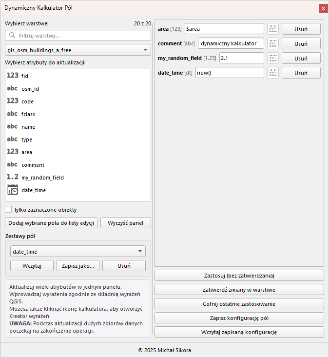
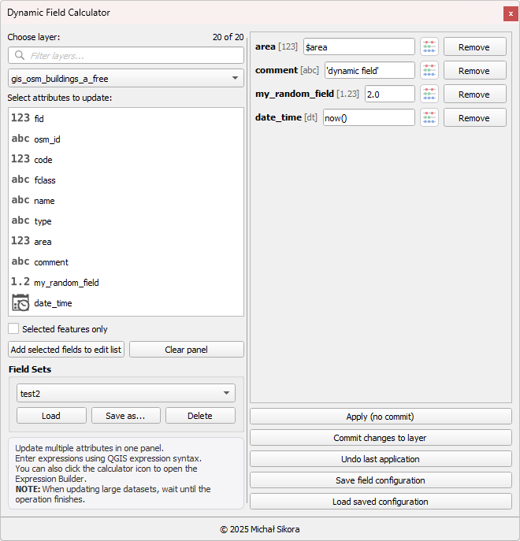

## [PL]/[EN]

## [PL] Dynamiczny Kalkulator Pól

**Dynamiczny Kalkulator Pól** umożliwia **jednoczesną aktualizację wielu atrybutów** w wybranej warstwie wektorowej przy użyciu wyrażeń QGIS — w jednym, przejrzystym panelu.  
Została zaprojektowana, aby znacznie przyspieszyć pracę z danymi atrybutowymi w projektach GIS.
---

## Nowości w wersji 2.0.0

- zgodność z QGIS 4 oraz minimalna wersja QGIS 3.34,
- filtrowanie warstw wektorowych po nazwie bez zmiany wybranej warstwy roboczej,
- wygodniejsza praca z panelem: długie nazwy warstw nie poszerzają go, a szerokość listy pól i obszaru wyrażeń można regulować,
- bezpieczniejsze zapisywanie i cofanie: nieudany zapis zachowuje niezależne edycje, a cofnięcie dotyczy wyłącznie ostatniej operacji wtyczki,
- poprawiona obsługa wyrażeń wymagających wszystkich atrybutów, identyfikacji warstw w zapisanych konfiguracjach oraz pól JSON w GeoPackage,
- poprawne usuwanie panelu po wyłączeniu lub przeładowaniu wtyczki.

---

---

## Funkcje

Wtyczka umożliwia m.in.:  
- wybór dowolnej warstwy wektorowej dostępnej w projekcie,  
- filtrowanie warstw po nazwie bez zmiany wybranej warstwy roboczej,
- wybranie wielu pól do edycji jednocześnie,  
- wpisanie różnych wyrażeń QGIS dla każdego pola w jednym panelu,  
- otwieranie **Kreatora wyrażeń** bezpośrednio z poziomu wtyczki,  
- **podgląd zmian** bez zapisywania ich do warstwy,  
- finalny zapis zmian lub ich odrzucenie,  
- opcję działania **tylko na zaznaczonych obiektach**,  
- zapamiętywanie ostatniego zestawu ustawień i wyrażeń,  
- działanie w formie **dokowalnego panelu bocznego**,  

---

## Interfejs

Panel składa się z dwóch głównych części:

### **Lewa kolumna**
- wybór warstwy wektorowej,  
- lista wszystkich edytowalnych pól,  
- opcja „Tylko zaznaczone obiekty”,  
- przyciski dodawania pól do edycji i czyszczenia panelu,  
- krótki panel pomocy.

### **Prawa kolumna**
- dynamicznie tworzone wiersze edycyjne dla wybranych pól,  
- dla każdego pola:
  - jego nazwa i typ,  
  - pole na wyrażenie QGIS,  
  - przycisk otwierający Kreator wyrażeń,  
  - przycisk usunięcia pola z listy edycyjnej,  
- przyciski operacyjne:
  - **Zastosuj (bez zapisu zmian)**  
  - **Zapisz zmiany na warstwie**  
  - **Cofnij ostatnie zastosowanie**  
  - **Zapisz konfigurację**  
  - **Wczytaj konfigurację**

---

## Instalacja

### **1. Instalacja z ZIP**
1. Pobierz najnowszą wersję wtyczki (plik `.zip`) z zakładki *Releases* repozytorium.
2. W QGIS przejdź do:  
   **Wtyczki → Zainstaluj z pliku ZIP**
3. Wskaż pobrany plik `.zip`.
4. Wtyczka pojawi się w menu i na pasku **Dynamiczny Kalkulator Pól**.

### **2. Instalacja ręczna**
Skopiuj folder `Dynamiczny_kalkulator_pol` do katalogu:
- Windows: `%APPDATA%\QGIS\QGIS3\profiles\default\python\plugins`
- Linux/macOS: `~/.local/share/QGIS/QGIS3/profiles/default/python/plugins`

W QGIS 4 użyj analogicznego katalogu profilu `QGIS4` zamiast `QGIS3`. Pliki wtyczki są identyczne dla obu wersji.

---

## Wymagania

- **QGIS 3.34 lub nowszy, także QGIS 4.x**  
- Python (zawarty w instalacji QGIS)  
- Obsługa Qt5/Qt6 (wtyczka wspiera Qt6)

---

## Jak używać wtyczki

1. Uruchom QGIS i aktywuj wtyczkę z listy zainstalowanych wtyczek.  
2. Na pasku „Dynamiczny Kalkulator Pól” kliknij ikonę wtyczki.  
3. W panelu bocznym:
   - wybierz warstwę,  
   - wskaż pola, które chcesz modyfikować,  
   - wpisz wyrażenia QGIS,  
   - kliknij **Zastosuj**, aby zobaczyć zmiany bez zapisu,  
   - jeśli wszystko jest poprawne — kliknij **Zapisz zmiany**. Wtyczka poprosi o potwierdzenie, ponieważ zapis obejmuje wszystkie oczekujące zmiany warstwy.

Przycisk **Cofnij ostatnie zastosowanie** cofa tylko najnowszą operację wykonaną przez wtyczkę. Jeżeli później wykonano inne edycje, użyj historii cofania QGIS, aby samodzielnie wybrać operację.

W trakcie pracy możesz otworzyć Kreator wyrażeń QGIS, aby szybko tworzyć i testować formuły.

---

## Przykłady zastosowań

- masowa aktualizacja dat, flag logicznych lub wartości liczbowych,  
- obliczenia geometryczne,  
- kopiowanie wartości między polami,  
- normalizacja danych atrybutowych,  
- wyliczanie wskaźników na podstawie kilku pól jednocześnie.

---

## Zapisywanie konfiguracji

Wtyczka umożliwia zapamiętanie zestawu ostatnio używanych ustawień, w tym:
- identyfikatora i nazwy warstwy,  
- stanu checkboxa „Tylko zaznaczone obiekty”,  
- wyrażeń przypisanych do pól.

Konfiguracja przechowywana jest w QGIS QSettings.

---

## Autor

**Michał Sikora**  
Kontakt: **michal.k.sikora@gmail.com**

---

## ENGLISH

## [EN] Dynamic Field Calculator

**Dynamic Field Calculator** allows **simultaneous updating of multiple attributes** in a selected vector layer using QGIS expressions — all within a single, clear panel.
It was designed to significantly speed up attribute data editing in GIS projects.

---

## WHAT'S NEW IN VERSION 2.0.0

- QGIS 4 support; the minimum QGIS version is now 3.34,
- filter vector layers by name without changing the selected working layer,
- improved panel usability: long layer names no longer widen the panel, and the field-list and expression-area widths are adjustable,
- safer saving and undo: a failed save preserves unrelated edits, while undo affects only the latest plugin operation,
- improved handling of expressions that require all attributes, layer identification in saved configurations, and GeoPackage JSON fields,
- the panel is removed correctly when the plugin is disabled or reloaded.

---

---

## FEATURES
- Select any vector layer available in the project
- Filter vector layers by name without changing the selected working layer
- Edit multiple fields at the same time
- Use different QGIS expressions for each field in a single panel
- Open the Expression Builder directly from the plugin
- Preview changes without saving them to the layer
- Save or discard changes
- Apply changes only to selected features
- Remember the last used settings and expressions
- Work as a dockable side panel

---

## INTERFACE

### **Left column:**
- Vector layer selection
- List of all editable fields
- “Selected features only” option
- Buttons for adding fields and clearing the panel
- Short help section

### **Right column:**
- Dynamically generated edit rows for selected fields
- Field name and type
- QGIS expression input
- Expression Builder button
- Remove field button
- Action buttons:
  - **Apply (without saving changes)**
  - **Save changes to layer**
  - **Undo last application**
  - **Save configuration**
  - **Load configuration**

---

## INSTALLATION

### Install from ZIP:
1. Download the latest plugin version (.zip) from the Releases tab.
2. In QGIS go to Plugins → Install from ZIP.
3. Select the downloaded file.
4. The plugin will appear in the Dynamic Field Calculator menu and toolbar.

### Manual installation:
Copy the Dynamiczny_kalkulator_pol folder to:
- Windows: `%APPDATA%\QGIS\QGIS3\profiles\default\python\plugins`
- Linux/macOS: `~/.local/share/QGIS/QGIS3/profiles/default/python/plugins`

For QGIS 4, use the corresponding `QGIS4` profile directory instead of `QGIS3`. The plugin files are identical for both versions.

---

## REQUIREMENTS
- QGIS 3.34 or newer, including QGIS 4.x
- Python (included with QGIS)
- Qt5 / Qt6 support

---

## USAGE
1. Enable the plugin in QGIS.
2. Open Dynamic Field Calculator from its toolbar.
3. Select a layer, choose fields, enter expressions.
4. Click Apply to preview changes.
5. Click Save changes to commit them. The plugin asks for confirmation because the commit includes every pending edit in the layer.

**Undo last application** reverses only the most recent operation performed by the plugin. If newer edits exist, use the QGIS undo history to choose the operation manually.

---

## EXAMPLES
- Bulk attribute updates
- Geometry-based calculations
- Copying values between fields
- Attribute normalization
- Calculating indicators from multiple fields

---

## CONFIGURATION
The plugin stores:
- Selected layer ID and name (the name is a fallback for older configurations)
- Selected-features-only state
- Field expressions
using QGIS QSettings.

---

## AUTHOR
**Michał Sikora**
Contact: **michal.k.sikora@gmail.com**
